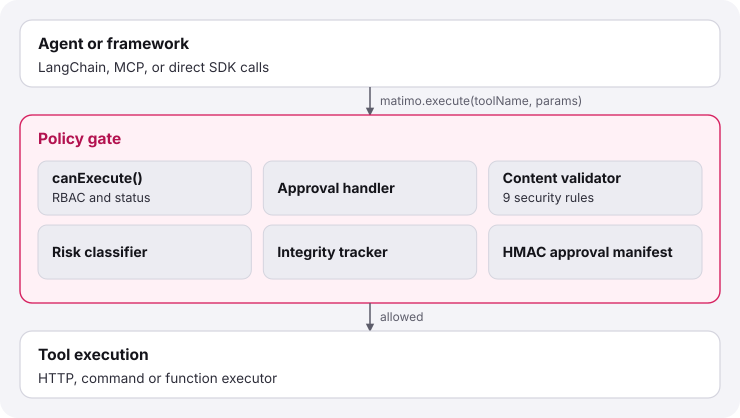

# Matimo - Policy-Governed Tool Execution for AI Agents

<p align="center">
  
</p>
<p align="center">
    <strong>A policy gate for agent tools. Meta-tools run under approval, not as an IQ boost.</strong>
</p>

<p align="center">
  <a href="https://github.com/tallclub/matimo/actions/workflows/ci.yml?branch=main"></a>
  <a href="https://www.npmjs.com/package/matimo"></a>
  <a href="https://pypi.org/project/matimo/"></a>
  <a href="https://opensource.org/licenses/MIT"></a>
  <a href="https://www.python.org/"></a>
  <a href="https://nodejs.org/"></a>
  <a href="https://discord.gg/3JPt4mxWDV"></a>
</p>

<p align="center">
  <a href="https://matimo.dev">Docs</a> ·
  <a href="#quick-start-no-api-keys-needed">Quick Start</a> ·
  <a href="./typescript/examples">Examples (TS)</a> ·
  <a href="./python/examples">Examples (Python)</a> ·
  <a href="https://discord.gg/3JPt4mxWDV">Community</a> ·
  <a href="https://colab.research.google.com/github/tallclub/matimo/blob/main/docs/notebooks/00_index.ipynb">Colab</a>
</p>

Matimo is a governance layer for the tools AI agents call. Define a tool once in YAML; run it from Python, TypeScript, LangChain, CrewAI or MCP. A policy engine sits between the agent and every tool: it classifies the call by risk (low, medium, high, critical), applies deterministic security rules, asks a human when the risk calls for it, and emits an audit event. That holds for built-in tools, third-party providers and tools an agent writes for itself.

## Who this is for

- **Agents that call external systems** (APIs, databases, email, shell) and need risk gates, human approval and an audit trail.
- **Teams on more than one framework**: one YAML tool definition runs from Python, TypeScript, LangChain, CrewAI and MCP, with the same policy everywhere.
- **Agents that grow their own tools at runtime**, without silently running untrusted code.

## Quick Start (no API keys needed)

**About 30 seconds · no API keys · `pip install matimo`**

`calculator` is built in and needs no credentials, so you can see a governed tool call working right away.

**Python** (3.11+)

```bash
pip install matimo
```

```python
import asyncio
from matimo import Matimo

async def main():
    matimo = await Matimo.init(auto_discover=True)
    print(await matimo.execute('calculator', {'operation': 'add', 'a': 5, 'b': 3}))
    print(await matimo.execute('calculator', {'expression': 'sqrt(16) + 2^3'}))

asyncio.run(main())
# {'result': 8.0, 'operation': 'add', ...}
# {'result': 12.0, 'operation': 'expression', ...}
```

**TypeScript** (Node 22.19+, ES modules)

```bash
npm install matimo
```

```typescript
import { MatimoInstance } from 'matimo';

const matimo = await MatimoInstance.init({ autoDiscover: true });
console.log(await matimo.execute('calculator', { operation: 'add', a: 5, b: 3 }));
console.log(await matimo.execute('calculator', { expression: 'sqrt(16) + 2^3' }));
```

> On first run you will see a `No MATIMO_APPROVAL_SECRET set` warning. It is harmless for local experiments; set a long random value before you rely on approvals (required when `NODE_ENV` or `MATIMO_ENV` is `production`).

### Next: your own tool, still no key

Most tools are one YAML file describing an HTTP call. This one calls the public JSONPlaceholder test API.

`tools/get_user/definition.yaml`

```yaml
name: get_user
description: Look up a user by id on the JSONPlaceholder test API
version: '1.0.0'
parameters:
  id: { type: number, required: true, description: 'User id (1-10)' }
execution:
  type: http
  method: GET
  url: 'https://jsonplaceholder.typicode.com/users/{id}'
```

```python
matimo = await Matimo.init('./tools')
user = await matimo.execute('get_user', {'id': 1})
print(user['name'], '-', user['email'])   # Leanne Graham - Sincere@april.biz
```

The policy engine rated that call (a plain `GET` is low risk) and let it through. The same definition works from TypeScript with `MatimoInstance.init('./tools')`; there the response body is in `result.data`.

### Then: real providers (these need API keys)

Provider packages wrap real services and need their own credentials in your environment (for example `SLACK_BOT_TOKEN`). Anything that writes is at least medium risk, so give the instance a reviewer for calls that must ask first.

```bash
pip install matimo-slack          # Python
npm install matimo @matimo/slack  # TypeScript
```

```python
async def on_approval(request) -> bool:
    return await confirm_with_user(request.tool_name, request.params)

matimo = await Matimo.init(auto_discover=True, on_approval=on_approval)
await matimo.execute('slack_send_channel_message', {'channel': '#general', 'text': 'Hello from Matimo!'})
```

Calls that need approval and have no reviewer are refused, not run. See the [Approval System](./docs/api-reference/APPROVAL-SYSTEM.md).

## How a call is governed

<p align="center">
  <picture>
    <source media="(prefers-color-scheme: dark)" srcset="./website/src/assets/diagrams/policy-gate-dark.svg">
    
  </picture>
</p>

| Risk | Typical shape | Behaviour |
|---|---|---|
| low | HTTP `GET` | runs |
| medium | HTTP `POST`, `PUT`, `PATCH` | runs, or asks first when HITL is on |
| high | HTTP `DELETE`, shell commands, `requires_approval: true` | asks a human before every call |
| critical | arbitrary code, such as `execute` | blocked for agent-created tools; developer-authored `function` tools use their declared `risk:` |

Add an audit sink and every event goes to a hash-chained log in which an edit or deletion is detectable. Full reference: [Policy & Lifecycle](./docs/api-reference/POLICY_AND_LIFECYCLE.md).

## Meta-tools: agents that extend themselves, under control

Matimo ships 15 meta-tools (`matimo_validate_tool`, `matimo_create_tool`, `matimo_approve_tool`, `matimo_reload_tools`, `matimo_get_tool_status`, `matimo_create_skill`, and more). They are **not** a way to make a model smarter. They are a governed loop that lets an agent propose a new capability while a human and the policy engine stay in charge:

<p align="center">
  <picture>
    <source media="(prefers-color-scheme: dark)" srcset="./website/src/assets/diagrams/agent-tool-lifecycle-dark.svg">
    
  </picture>
</p>

<details>
<summary>Show the full create, approve and reload flow</summary>

```python
matimo = await Matimo.init(
    './agent-tools',
    auto_discover=True,
    untrusted_paths=['./agent-tools'],  # agent-written tools must pass the content rules
    on_approval=ask_reviewer,           # a human answers every call that needs approval
)

# 1. The agent writes a tool definition. It is saved as a draft.
await matimo.execute('matimo_create_tool', {
    'name': 'stripe_create_payment', 'yaml_content': yaml_content, 'target_dir': './agent-tools',
})
# 2. A human reviews the draft and approves it.
await matimo.execute('matimo_approve_tool',
    {'name': 'stripe_create_payment', 'tool_dir': './agent-tools'},
    context=PolicyContext(agent_id='reviewer', roles=['admin']))
# 3. Reload, then use it. Every call still asks the reviewer.
await matimo.execute('matimo_reload_tools', {})
```

</details>

**Governance in practice.** With `untrusted_paths` set, a tool the agent submits that tries to run code is rejected before it is saved:

```text
[critical] no-function-execution: Function execution tools are not permitted for untrusted sources
```

An agent-written HTTP tool, by contrast, is accepted as a `draft` in state `pending` and does nothing until a human approves it. Developer-authored tools in trusted paths, such as `calculator` above, run normally. The nine content rules are listed in [Policy & Lifecycle](./docs/api-reference/POLICY_AND_LIFECYCLE.md).

## Works with your stack

| You use | How | Docs |
|---|---|---|
| Python or TypeScript directly | `matimo.execute(name, params)` (factory) or the `@tool` decorator | [SDK patterns](./docs/user-guide/SDK_PATTERNS.md) |
| LangChain | `convert_tools_to_langchain` / `convertToolsToLangChain` | [LangChain](./docs/framework-integrations/LANGCHAIN.md) |
| CrewAI, Agno (Python) | `pip install "matimo[crewai]"`, `"matimo[agno]"` | [Python SDK](./python/README.md) |
| MCP clients (Claude Desktop, Cursor, Windsurf) | `npx matimo mcp`, stdio or Streamable HTTP | [MCP](./docs/MCP.md) |

Every integration goes through the same policy engine, so a rule you set once applies everywhere.

## What's included

- **Policy engine**: risk classification, 9 content rules, per-call approval, HITL quarantine, HMAC-signed approvals, hash-chained audit log, policy hot-reload.
- **Core tools**: calculator, file read/edit/search, web fetch and scrape, file conversion, and an approval-gated `execute` for shell commands.
- **10 provider packages, 129 tools in total**: Slack, Gmail, GitHub, Notion, HubSpot, Postgres, Twilio, Mailchimp, Microsoft Graph, Bruno. Needs each provider's credentials.
- **Governed Composio catalog** (TypeScript only): 449 more tools routed through [Composio](https://composio.dev) with Matimo's policy and HITL on top. See [why](./typescript/packages/composio/README.md#-credit-where-its-due).
- **Skills**: `SKILL.md` knowledge files ([Agent Skills spec](https://agentskills.io)) with TF-IDF search and section loading. See [Skills](./docs/skills/SKILLS.md).
- **CLI** (`npm install -g @matimo/cli`): `matimo list`, `matimo search`, `matimo install`, `matimo mcp setup`.

The two SDKs aim for parity; the Composio catalog and a few instance methods are TypeScript-only (see [SDK.md](./docs/api-reference/SDK.md)).

**0.4.0** (one version for both SDKs): HTTP MCP servers bind localhost by default, network tools refuse internal addresses, `execute` takes `args` and an opt-in `shell` that always asks a human. Read the [CHANGELOG](./CHANGELOG.md) before upgrading.

## Contributing

Contributions are welcome, and the easiest way in is a new provider or a new tool on an existing one.

- Start with [CONTRIBUTING.md](./CONTRIBUTING.md), which has a "Good First Contributions" section. Larger changes: open a [Discussion](https://github.com/tallclub/matimo/discussions) first.
- **Add a provider**: follow [Adding Tools](./docs/tool-development/ADDING_TOOLS.md). A provider is a package of YAML definitions plus one `SKILL.md`, so most need no code. We list community providers in the docs with you as maintainer.
- **Security issues**: please report privately, see [SECURITY.md](./SECURITY.md).
- Bugs and ideas: [Issues](https://github.com/tallclub/matimo/issues) · Chat: [Discord](https://discord.gg/3JPt4mxWDV).

From source:

```bash
git clone https://github.com/tallclub/matimo
cd matimo/typescript && pnpm install && pnpm build && pnpm test   # TypeScript
cd ../python && make install && make test                          # Python
```

## Documentation

[Getting Started](./docs/getting-started/) · [Python SDK](./python/README.md) · [API Reference](./docs/api-reference/SDK.md) · [Policy & Lifecycle](./docs/api-reference/POLICY_AND_LIFECYCLE.md) · [Skills](./docs/skills/SKILLS.md) · [Tool Development](./docs/tool-development/ADDING_TOOLS.md) · [Architecture](./docs/architecture/OVERVIEW.md) · [Roadmap](./docs/ROADMAP.md)

Want a hosted runtime with a visual builder on top of this governance layer? See [Matimo Workbench](https://matimo.ai).

## Acknowledgments

Broad integration coverage (Asana, Jira, Linear, Google Workspace, Microsoft 365 and more, 449 tools in all) is made possible today by [Composio](https://composio.dev), whose catalog `@matimo/composio` wraps with Matimo's policy engine, risk classification and HITL approval. We use it as a deliberate, temporary bridge while we grow native `@matimo/<provider>` packages for the highest-usage toolkits. See [the composio package README](./typescript/packages/composio/README.md#-credit-where-its-due) for the rationale.

## License

MIT © 2026 ROAIQ TECHNOLOGIES PRIVATE LIMITED

---

## Contributors

<!-- ALL-CONTRIBUTORS-LIST:START - Do not remove or modify this section -->
<!-- prettier-ignore-start -->
<!-- markdownlint-disable -->

<div align="left">
  <a href="https://github.com/tallclub"></a>
  <a href="https://github.com/Genmin"></a>
  <a href="https://github.com/marketcalls"></a>
  <a href="https://github.com/Nitjsefnie"></a>
</div>

<!-- markdownlint-enable -->
<!-- prettier-ignore-end -->

<!-- ALL-CONTRIBUTORS-LIST:END -->

---

## Star History

[](https://star-history.com/#tallclub/matimo&Date)
