Understand how Matimo's monorepo structure works and how components interact.

## High-Level Runtime Architecture


Read it top to bottom. Your code reaches Matimo through one of four entry points, and every one lands in the same `MatimoInstance`. Nothing reaches an executor without passing the policy gate: untrusted tools are validated when they load, and every call is risk-classified, gated, and approved by a human where required. Tool and skill definitions are loaded into the orchestrator at init and on reload.

## Monorepo Organization

The repository holds two SDKs that share one tool format. `typescript/` is a pnpm workspace and `python/` a uv workspace; every package has a Python counterpart except `@matimo/composio`, which is TypeScript-only.

```
typescript/packages/core          # Core SDK (@matimo/core on npm)   ↔ python/packages/core (matimo-core)
├── src/                          # Orchestration, executors, policy, approval, MCP server, integrations
├── tools/                        # 9 built-in tools + 15 matimo_* meta-tools
│   ├── calculator, web, web_scraper, convert_to_file, extract_from_file, execute, read, edit, search
│   ├── matimo_validate_tool / matimo_create_tool / matimo_approve_tool
│   ├── matimo_reload_tools / matimo_list_user_tools / matimo_get_tool_status
│   ├── matimo_get_tool / matimo_search_tools
│   ├── matimo_create_skill / matimo_list_skills / matimo_get_skill / matimo_validate_skill
│   └── matimo_search_skills / matimo_get_skill_sections / matimo_get_skill_content
└── skills/                       # 6 core SKILL.md files
    ├── tool-creation/  meta-tools-lifecycle/  policy-validation/
    └── tool-discovery/  skill-creator/  skills-catalog/

typescript/packages/<provider>    # @matimo/slack, gmail, github, hubspot, notion, postgres,
├── tools/<tool>/definition.yaml  #   twilio, mailchimp, microsoft, bruno, composio
├── skills/<provider>/SKILL.md
└── definition.yaml               # OAuth2 provider config, where the provider uses OAuth2

typescript/packages/cli           # matimo CLI (@matimo/cli): install, list, search, doctor, review, mcp

typescript/examples/tools/        # Per-provider examples (factory, decorator, LangChain, with-approval),
                                  # plus policy/, skills/, meta-flow/ and agents/
python/examples/                  # native/, langchain/, crewai/, mcp/
```

The Python side mirrors the TypeScript layout. Replace `typescript/packages/core/src` with `python/packages/core/src/matimo` (a package per concern: `instance.py`, `core/`, `executors/`, `policy/`, `approval/`, `auth/`, `mcp/`, `integrations/`, `tools/`):

```
python/packages/core              # matimo-core on PyPI
python/packages/matimo            # "matimo" meta-package: pulls in matimo-core and matimo-cli
python/packages/cli               # matimo-cli
python/packages/<provider>        # matimo-slack, matimo-gmail, matimo-github, ... (no composio)
```

**Key principle:** Each package installs on its own from npm or PyPI. A tool's YAML is the single source of truth for both SDKs.

---

## Component Layers

### 1. Application Layer

Your code that uses Matimo. Examples:

- Express.js API endpoint
- LangChain agent
- CLI tool
- Scheduled job
- Discord bot

### 2. SDK Layer (packages/core)

**Factory Pattern**:

```typescript
import { MatimoInstance } from 'matimo';

const m = await MatimoInstance.init({ autoDiscover: true });
const result = await m.execute('calculator', params);
```

**Decorator Pattern**:

```typescript
import { tool } from 'matimo';

class Agent {
  @tool('calculator')
  async calculate(...) { }
}
```

**Python**:

```python
from matimo import Matimo, tool

# Factory pattern
m = await Matimo.init(auto_discover=True)
result = await m.execute("calculator", {"operation": "add", "a": 5, "b": 3})

# Decorator pattern
class Agent:
    def __init__(self, matimo: Matimo) -> None:
        self._matimo = matimo

    @tool("calculator")
    async def calculate(self, operation: str, a: float, b: float): ...
```

### 3. Core Orchestration (packages/core/src)

**MatimoInstance**: Central orchestrator that:

- Initializes tool loading
- Manages auto-discovery
- Runs every call through the policy gate, HITL quarantine and per-call approval
- Coordinates execution
- Handles errors
- Injects credentials (environment variables or per-call `credentials`)
- Emits events to `onEvent` and the `auditSink`
- Runs `matimo_reload_tools` on itself, since a reload rebuilds its registry

It does not validate parameters against the YAML before running a tool; the tool or the API it calls reports bad input.

### 4. Tool Management (packages/core/src/core)

**ToolLoader** (internal): Loads tools from YAML files

- Reads from `packages/{provider}/tools/*/definition.yaml`
- Validates against Zod schema
- Returns `ToolDefinition[]`
- Auto-discovers packages from `node_modules/@matimo/*/tools`

**ToolRegistry** (internal): In-memory index of all tools

```
tools: Map<name, ToolDefinition>
|
├── calculator (from packages/core/tools/)
├── slack-send-message (from packages/slack/tools/)
├── slack-list-channels (from packages/slack/tools/)
├── gmail-send-email (from packages/gmail/tools/)
├── matimo_validate_tool (built-in meta-tool)
├── matimo_create_tool   (built-in meta-tool)
├── matimo_approve_tool  (built-in meta-tool)
└── ...
```

### 5. Execution Layer (packages/core/src/executors)

**FunctionExecutor** (Primary for Core Tools): Executes JavaScript/TypeScript functions directly

```
Input: { code: "execute.ts", params: {...} }
Process: Import and call function directly (no subprocess)
Output: { result }
```

Used by all 9 core tools: `execute`, `read`, `edit`, `search`, `web`, `calculator`, `web_scraper`, `convert_to_file`, `extract_from_file`

**HttpExecutor**: Makes HTTP requests with automatic validation

```
Input: { method: "POST", url: "...", headers: {...}, body: {...} }
Process: Embed params, re-check the final URL for SSRF targets, send the request
Output: { success, data, statusCode, headers }   (Python returns the parsed body)
```

Both language implementations enforce a coarse 50 MB upstream size ceiling on the raw response as defense in depth, independent of the response-size guardrail applied later in `execute()` (see [Tool Execution Flow](#tool-execution-flow)): TypeScript sets axios's `maxContentLength`/`maxBodyLength`; Python streams the response manually via `httpx`'s `client.stream()` and aborts once the declared `Content-Length` or the accumulated body exceeds the cap, since `httpx` has no direct equivalent option.

**CommandExecutor** (Shell Execution): Runs external shell commands. No built-in tool uses it; a `type: command` tool asks for approval on every call unless it declares `requires_approval: false`

```
Input: { command: "node script.js", args: [...] }
Process: Spawn child process
Output: { stdout, stderr, exitCode }
```

Used for external tools and legacy scripts that need subprocess execution.

### 6. Tool Definitions (YAML)

**Core Tools** (packages/core/tools/):

```yaml
name: calculator
execution:
  type: function
  code: './calculator.ts'
```

**Provider Tools** (packages/{provider}/tools/):

```yaml
name: slack-send-message
execution:
  type: http
  method: POST
  url: https://slack.com/api/chat.postMessage
```

**Provider Config** (packages/{provider}/definition.yaml):

```yaml
type: provider
name: slack
provider:
  endpoints:
    authorizationUrl: https://slack.com/oauth_authorize
```

### 7. External Services

Tools interact with:

- Google Gmail API
- Slack Web API
- GitHub REST API
- Shell commands
- Custom HTTP APIs

### 8. Policy Gate (packages/core/src/policy)

**PolicyEngine** (`DefaultPolicyEngine` unless you pass your own) works at two points.

When an **untrusted** tool loads (from `untrustedPaths`, or created by an agent), and when `matimo_create_tool` writes one:

- `allowCommandTools` / `allowFunctionTools`, whether untrusted command and function tools may load (default: `false`)
- `allowedHttpMethods`: HTTP verbs untrusted tools may use (default: `['GET', 'POST']`)
- `allowedDomains`, `allowedCredentials`, optional allow-lists
- `protectedNamespaces`: name prefixes untrusted tools cannot take (default: `['matimo_']`)
- **Content Validator**: 9 rules: `no-function-execution`, `no-command-execution`, `no-ssrf`, `unauthorized-credential`, `reserved-namespace`, `forced-approval`, `blocked-http-method`, `blocked-domain`, `forced-draft-status`

On **every call**, `canExecute()`:

- classifies the tool's risk (`low`, `medium`, `high`, `critical`)
- denies deprecated tools, drafts (in production, and elsewhere without the `admin` role), and `requires_approval` tools in production without `admin` or `operator`
- quarantines calls at or above `hitlMinRiskLevel` for the `onHITL` callback when `enableHITL` is on

After the policy, `execute()` asks for per-call approval (`onApproval`) when the tool requires it. `PolicyConfig` is frozen once `MatimoInstance.init()` completes.

For full details see [Policy Engine & Lifecycle](/docs/api-reference/policy-and-lifecycle/).

### 9. Meta-Tools Subsystem (packages/core/tools/matimo_*/)

Built-in tools that manage the tool lifecycle from within the agent. They are always present and cannot be removed or shadowed (protected namespace):

| Tool | Purpose |
|------|---------|
| `matimo_validate_tool` | Validate a YAML definition against schema + policy |
| `matimo_create_tool` | Write a new tool as a draft (`status: draft`, `requires_approval: true`) |
| `matimo_approve_tool` | Mark a draft `approved` and sign it in the approval manifest (HMAC) |
| `matimo_reload_tools` | Hot-reload the live registry without restarting |
| `matimo_list_user_tools` | List the tools in an agent tool directory, with risk and status |
| `matimo_get_tool_status` | Check lifecycle state of a single tool |
| `matimo_create_skill` | Create a new SKILL.md in the skills directory |
| `matimo_list_skills` | List available SKILL.md files |
| `matimo_get_skill` | Read a skill by name |
| `matimo_validate_skill` | Validate a skill against the Agent Skills spec |
| `matimo_search_skills` | Rank skills by keyword relevance to a query (TF-IDF) |
| `matimo_get_skill_sections` | Inventory a skill's sections and token costs without loading it |
| `matimo_get_skill_content` | Load only specific sections of a skill (token-efficient) |
| `matimo_get_tool` | Read one tool's YAML and parsed definition |
| `matimo_search_tools` | Search the loaded registry by keyword |

For full details see [Meta-Tools Reference](/docs/api-reference/meta-tools/).

### 10. Approval & Integrity Layer

When a tool is approved via `matimo_approve_tool`, the approval system:

1. Re-validates the tool, then sets `status: approved` in its `definition.yaml`
2. Computes a **SHA-256** hash of the updated file
3. Signs it with **HMAC-SHA256**, using `approvalSecret` / `MATIMO_APPROVAL_SECRET` (or a per-process key, so approvals last only for that process)
4. Records it in the owning instance's manifest, `.matimo-approvals.json` in `approvalDir` (default: the working directory)
5. On reload, a tool whose hash matches its signed record is re-checked with the narrower `canReload()`; anything else, including a hand-edited `status: approved`, goes through `canCreate()` again

An edit after approval changes the hash, so the tool must be approved again. Never commit `.matimo-approvals.json`.

For full details see [Approval System](/docs/api-reference/approval-system/).

### 11. Skills System (packages/core/skills/)

Skills are **SKILL.md** files that carry domain knowledge the agent can load on demand. Unlike tools (which execute actions), skills are read-only instruction documents.

```
packages/core/skills/
├── tool-creation/SKILL.md        # How to create Matimo tools
├── meta-tools-lifecycle/SKILL.md # How to use meta-tools
├── policy-validation/SKILL.md    # How to work within policy constraints
├── tool-discovery/SKILL.md       # How to discover available tools
├── skill-creator/SKILL.md        # How to write a skill
└── skills-catalog/SKILL.md       # Which skills exist
```

Agent runtime skills live in `./matimo-tools/skills/` (created by `matimo_create_skill`). Skills also support progressive disclosure, `matimo_search_skills` finds the right skill by meaning, `matimo_get_skill_sections` inventories its headings and token costs, and `matimo_get_skill_content` loads only the needed sections instead of the whole file.

For full details see [Skills System](/docs/skills/skills/).

---

## Agent Tool Lifecycle

For agents that create tools at runtime (e.g., autonomous coding agents), the full lifecycle is:

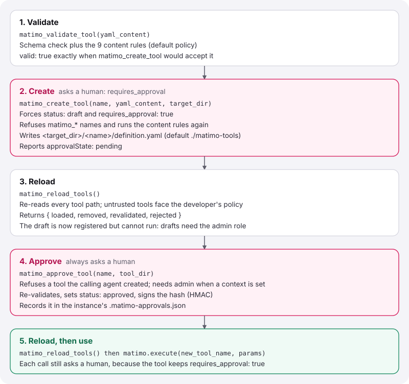
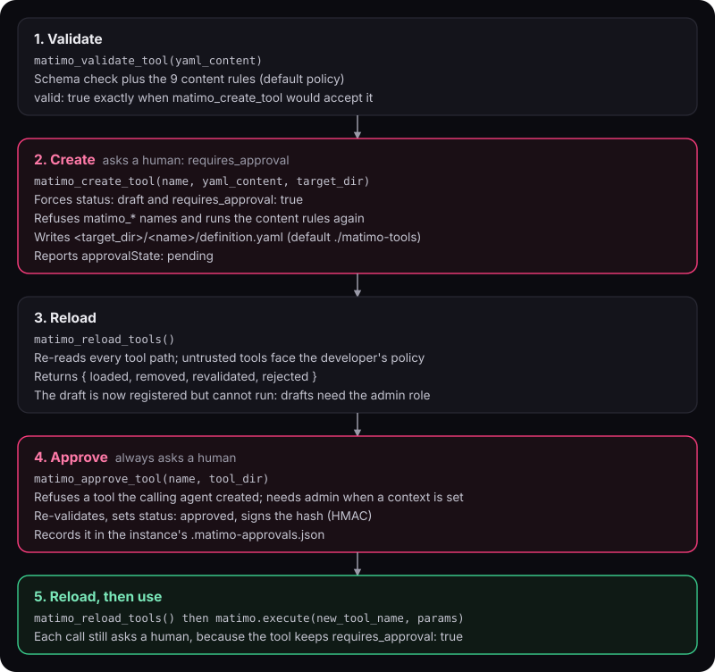

---

## Data Flow

### Tool Execution Flow

Every call takes the same path, whether it comes from the SDK, LangChain, CrewAI or MCP:

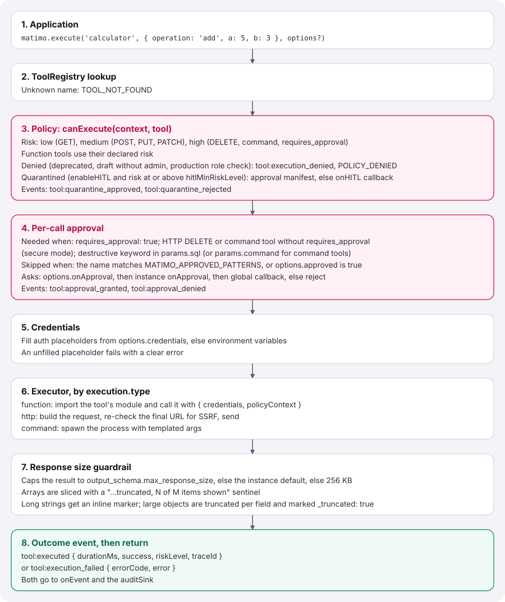
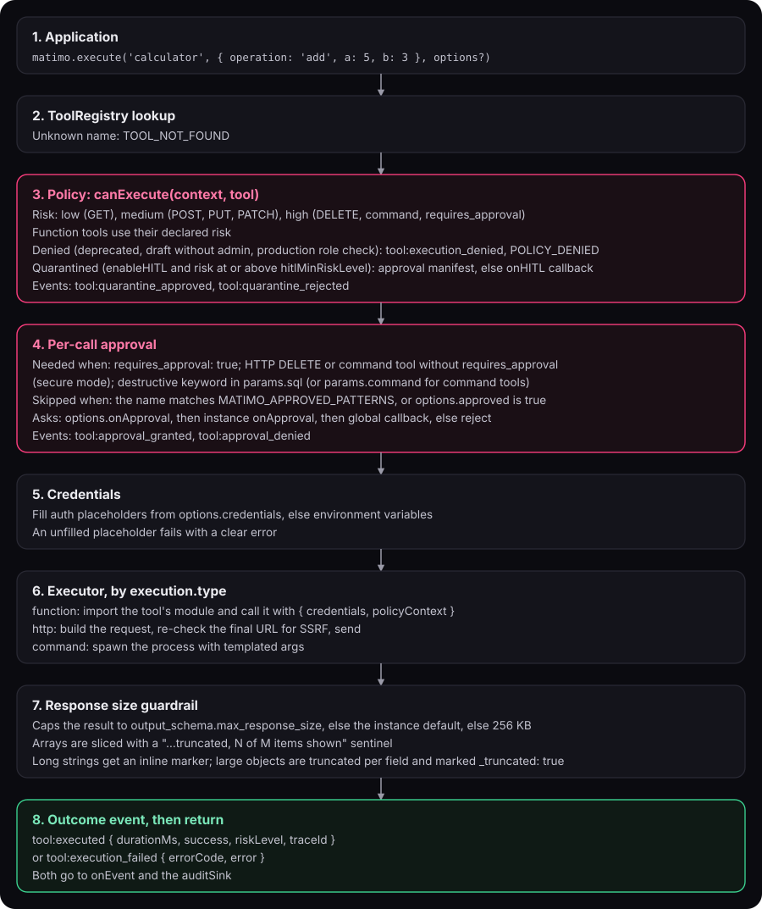

The calculator returns `{ result: 8 }`. An HTTP tool returns `{ success, data, statusCode, headers }` in TypeScript and the parsed body in Python.

### OAuth2 Token Flow

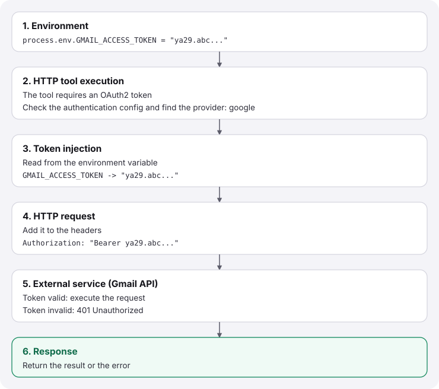
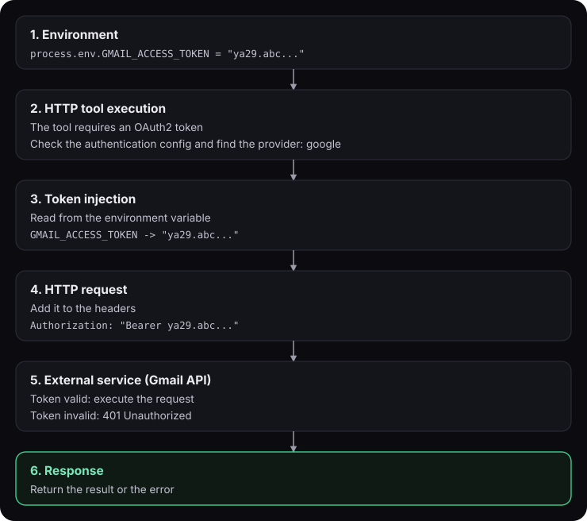

---

## Framework Integration Patterns

Matimo supports 3 patterns for integrating with AI frameworks like LangChain, where the LLM automatically decides which tool to use:

### Pattern 1: LangChain Official API (Recommended)

Uses LangChain's official `tool()` function with automatic schema generation:

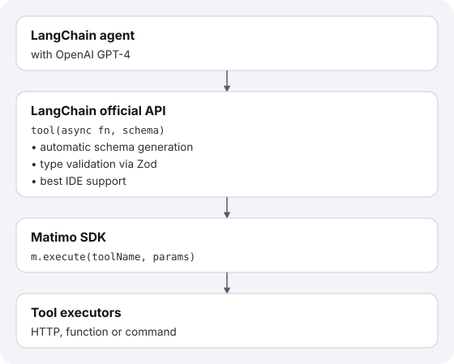
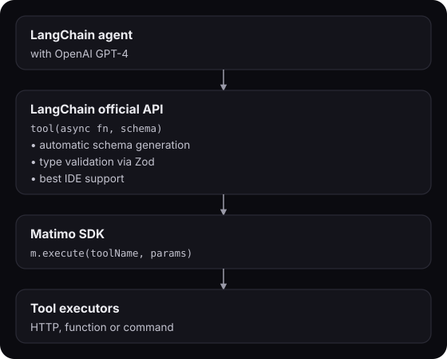

**When to use:** Default choice for AI agents with LangChain

### Pattern 2: Decorator Pattern with LangChain

Uses Matimo's `@tool()` decorators for class-based agents:

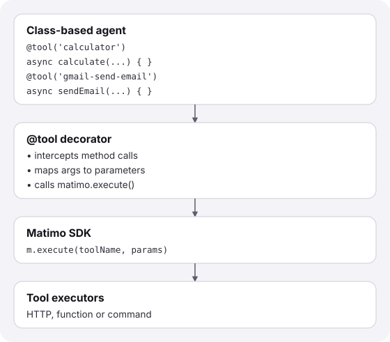
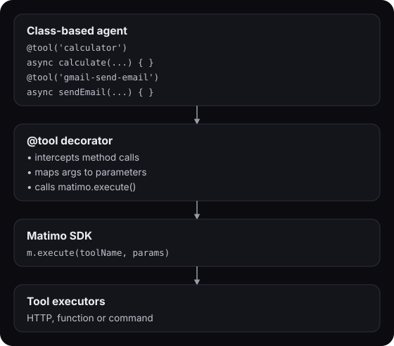

**When to use:** Class-based agents, automatic tool binding

### Pattern 3: Factory Pattern with LangChain

Direct `matimo.execute()` calls in agent logic:

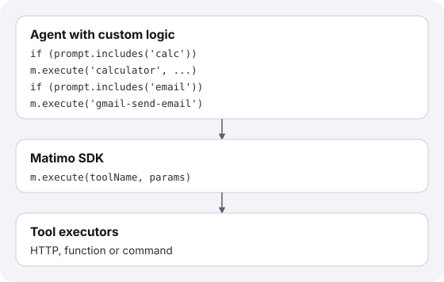
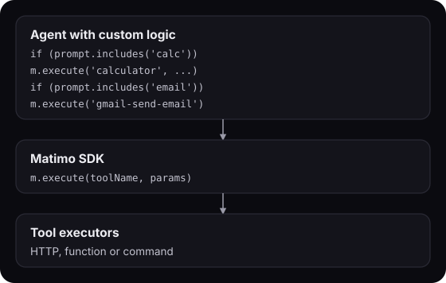

**When to use:** Simple logic, manual tool routing

### Comparison Matrix

| Aspect             | Official API       | Decorator          | Factory      |
| ------------------ | ------------------ | ------------------ | ------------ |
| **LLM-Driven**     | Yes (automatic) | Yes             | Manual    |
| **Schema Gen**     | Automatic       | Manual          | Manual    |
| **Type Safety**    | Excellent          | Excellent          | Good         |
| **Framework**      | LangChain+         | LangChain+         | Any          |
| **Best For**       | AI agents          | Class-based agents | Simple logic |
| **Learning Curve** | Low                | Medium             | Low          |

For full details, see [Framework Integrations - LangChain](/docs/framework-integrations/langchain/).

---

## Core Types

```typescript
// Tool Definition
interface ToolDefinition {
  name: string;
  description: string;
  version: string;
  parameters?: Record<string, Parameter>;
  execution: HttpExecution | CommandExecution | FunctionExecution;
  authentication?: AuthConfig;
  output_schema?: OutputSchema;
  tags?: string[];
  // Governance
  requires_approval?: boolean; // ask a human on every call
  risk?: 'low' | 'medium' | 'high' | 'critical'; // can only raise the computed risk
  status?: 'draft' | 'approved' | 'deprecated'; // unset = approved
}

// Execution Config (Function)
interface FunctionExecution {
  type: 'function';
  code: string; // path to the module, relative to the YAML
  timeout?: number;
}

// Execution Config (Command)
interface CommandExecution {
  type: 'command';
  command: string;
  args?: string[];
  cwd?: string;
  timeout?: number;
}

// Execution Config (HTTP)
interface HttpExecution {
  type: 'http';
  method: 'GET' | 'POST' | 'PUT' | 'DELETE' | 'PATCH';
  url: string;
  headers?: Record<string, string>;
  body?: unknown;
  query_params?: Record<string, string>;
}

// Provider Definition
interface ProviderDefinition {
  type: 'provider';
  name: string;
  provider: {
    endpoints: OAuth2Endpoints;
    // ...
  };
}
```

In Python the same shapes are Pydantic models in `matimo.core.models` (`ToolDefinition`, `Parameter`, `HttpExecution`, `CommandExecution`, `FunctionExecution`, `ProviderDefinition`), validated when the YAML loads, as Zod does in TypeScript. They accept extra keys, such as `notes:`, which the TypeScript schema drops.

---

## Validation Pipeline

Every tool goes through validation:

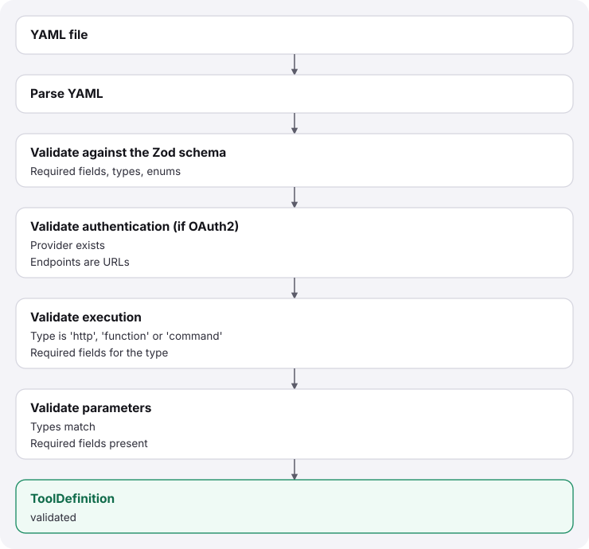
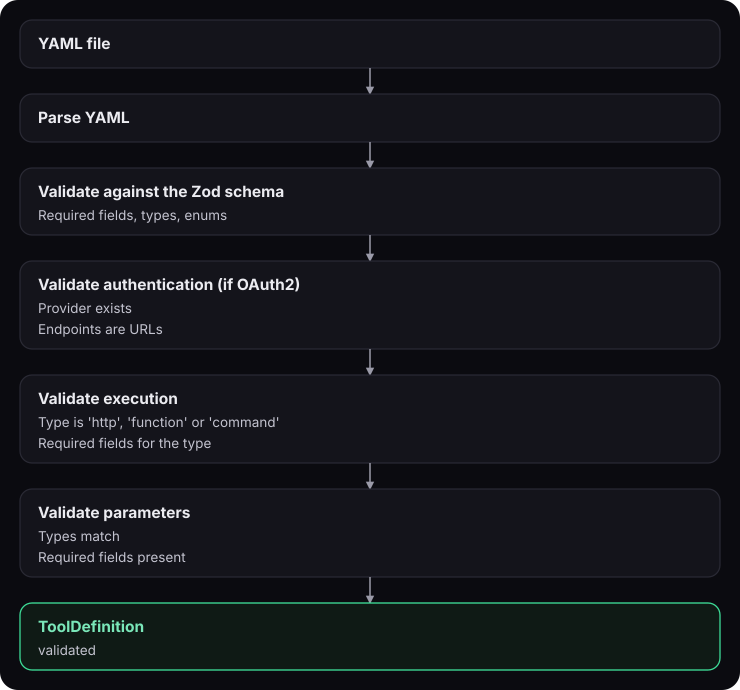

---

## Error Handling

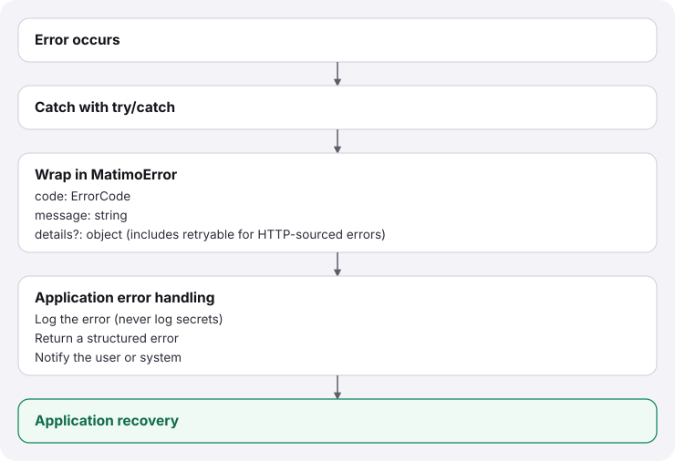
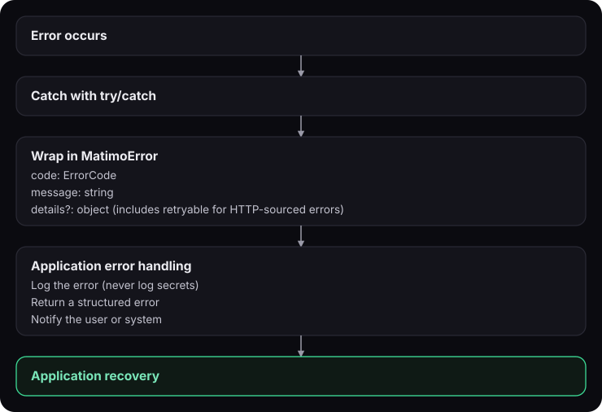

HTTP-sourced errors are mapped to specific codes rather than a single
generic failure, 401/403 → `AUTH_FAILED`, 429 → `RATE_LIMIT_EXCEEDED`,
other 4xx/5xx → `EXECUTION_FAILED`; a `retryable` flag on `details`
tells the caller whether the failure is worth retrying (true for 429
and 5xx). Network-level failures with no HTTP response at all (timeout,
DNS failure, connection refused) get their own `TIMEOUT`/`NETWORK_ERROR`
codes instead of being folded into `EXECUTION_FAILED`.

The MCP server surfaces this same structured data across the protocol
boundary: a failed tool call returns `isError: true` with a
`structuredContent` field carrying `{ code, statusCode, retryable,
message }`, rather than flattening the error into freeform text. See
[MCP Server docs, Tool Metadata & Error Responses](/docs/mcp-server/#tool-metadata--error-responses)
for the exact shape and [Error Codes Reference](/docs/api-reference/errors/)
for the full code list.

---

## Design Principles

### 1. Configuration-Driven

Tools defined in YAML, not code:

- Easy to update without redeploying
- Non-technical users can add tools
- Version control friendly

### 2. No Database

Matimo needs no server or database. The only state it writes is the approval manifest (`.matimo-approvals.json`) and, if you configure one, the audit log:

- Easy to embed and scale
- Simple to test

### 3. Multi-Provider

Support any OAuth2 provider:

- Google, GitHub, Slack out of box
- Add new providers with YAML
- No code changes needed

### 4. Type-Safe

Full TypeScript + Zod validation:

- Catch errors at load time
- IDE autocomplete support
- Zero `any` types

### 5. Framework-Agnostic

Works with any framework:

- Direct SDK usage
- LangChain (TypeScript and Python), CrewAI and Agno (Python)
- Any MCP client, through the MCP server
- Custom framework support
- Vercel AI, OpenAI and Anthropic SDK adapters

### 6. Secure by Default

Policy engine is on from the start:

- Every call is risk-classified and passes the execution gates
- DELETE and command tools ask a human unless they opt out (`governanceMode: 'legacy'` restores the old default)
- Untrusted command and function tools are blocked unless explicitly allowed
- Protected namespaces prevent shadowing built-in tools
- Agent-created tools must pass policy + content validation, and a human approves them
- Approved tools are HMAC-signed to prevent silent tampering
- Every call ends in an event; `JsonlFileSink` keeps a hash-chained audit log

---

## Extension Points

### Adding a New Tool

1. Create `tools/category/tool-name/definition.yaml`
2. Loader automatically discovers it
3. Validation confirms correctness
4. Ready to use

### Adding an Executor

There is no plug-in point for executors. A new execution type means a new `execution.type` in the Zod schema (`core/schema.ts`), an executor class in `executors/`, a case in `MatimoInstance`'s executor dispatch, and the same in the Python SDK.

### Adding a Provider

1. Create `tools/provider-name/definition.yaml`
2. Set `type: provider`
3. Configure OAuth2 endpoints
4. Tools reference provider in authentication

---

## Performance Characteristics

| Operation          | Time      | Notes                       |
| ------------------ | --------- | --------------------------- |
| Load tools         | ~50ms     | One-time, cached            |
| Validate schema    | ~5ms      | Per tool                    |
| Execute command    | Varies    | Depends on command          |
| Execute HTTP       | 100-500ms | Network dependent           |
| OAuth token inject | <1ms      | Environment variable lookup |

---

## Next Steps

- **[SDK Usage Patterns](/docs/user-guide/sdk-patterns/)**: How to use Matimo
- **[Tool Specification](/docs/tool-development/yaml-tools/)**: How to build tools
- **[Policy Engine & Lifecycle](/docs/api-reference/policy-and-lifecycle/)**: Security controls and tool lifecycle
- **[Meta-Tools Reference](/docs/api-reference/meta-tools/)**: Built-in tool management
- **[Approval System](/docs/api-reference/approval-system/)**: Who approves a call, and how
- **[Skills System](/docs/skills/skills/)**: Domain knowledge via SKILL.md
- **[Logging](/docs/api-reference/logging/)**: Winston logger integration
- **[Troubleshooting](/docs/troubleshooting/faq/)**: Common issues
